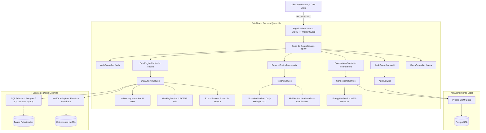

# Arquitectura Integral de DataNexus

> **Plataforma Unificada de Gestión de Datos Mixtas, Business Intelligence & Federación**  
> *Stack Tecnológico:* NestJS 12, TypeScript 5+, Prisma ORM, PostgreSQL (enums nativos para roles, motores y eventos), Swagger (OpenAPI).

---

## 1. Visión del Sistema
DataNexus es una plataforma empresarial diseñada para unificar silos relacionales (PostgreSQL, MySQL, SQL Server) y no relacionales (Firebase Firestore, MongoDB) en una experiencia unificada. Permite a perfiles técnicos y de negocio visualizar datos consolidados, realizar cruces entre bases heterogéneas (*Cross-Joins*), anonimizar información sensible según el rol del usuario, exportar informes corporativos (Excel, PDF, JSON) y programar despachos automatizados por correo electrónico.

---

## 2. Mapa de Fases del Proyecto

| Fase | Título | Descripción y Responsabilidad | Estado |
| :--- | :--- | :--- | :---: |
| **Fase 1** | **Cimientos Locales & ORM** | Configuración base de NestJS, SQLite para desarrollo local, PrismaClient global (`PrismaService`) y modelos fundacionales `Workspace` y `User`. | ✅ Completada |
| **Fase 2** | **Seguridad & Conexiones Cifradas** | Autenticación basada en JWT, encriptación simétrica AES-256-GCM para cadenas de conexión y CRUD seguro de `ConexionDB` (`ConnectionsModule`). | ✅ Completada (PR #1) |
| **Fase 3** | **Auditoría & Exploración de Esquemas** | Bitácora de eventos inmutable (`RegistroAuditoria`), control de roles (`ADMIN` / `LECTOR`) e introspección de esquemas externos mediante adaptadores. | ✅ Completada (PR #2) |
| **Fase 4** | **Motor de Cross-Joins en Memoria** | Algoritmo de unión relacional (*Inner Join*) en memoria con indexación hash $O(N + M)$ sobre tablas SQL y colecciones NoSQL con paginación nativa (`limit`, `offset`). | ✅ Completada (PR #3) |
| **Fase 5** | **Data Masking & Exportación** | Anonimización dinámica de correos, teléfonos y secretos para rol `LECTOR` (`MaskingService`) y generación de archivos binarios descargables en Excel (`exceljs`), PDF (`pdfkit`) y JSON (`ExportService`). | ✅ Completada (PR #3) |
| **Fase 6** | **Automatización de Reportes & Cron** | Programación periódica a la medianoche con `@nestjs/schedule` (CronJobs), servicio de despacho por correo (`nodemailer`) con reportes adjuntos para analistas. | ✅ Completada (Issue #4) |
| **Fase 7** | **Seguridad Perimetral, CORS & Rate Limiting** | Políticas CORS estrictas para Next.js (local y producción) y protección contra sobrecarga de CPU con `@nestjs/throttler` (20 req/min en exportaciones). | ✅ Completada (Issue #6) |
| **Fase 8** | **Ecosistema Empresarial & Miembros** | Gestión de miembros del Workspace, invitaciones con roles y contraseñas temporales, y aislamiento multi-tenant por Workspace. | ✅ Completada |

---

## 3. Diagrama de Arquitectura

---

## 4. Catálogo de Módulos y Endpoints Principales

### 4.1 Autenticación (`/auth`)
- `POST /auth/register`: Registro inicial de empresa, workspace y usuario administrador.
- `POST /auth/login`: Autenticación con email/contraseña. Abre una sesión y devuelve `access_token` (JWT de 15 min),
  `refresh_token` y `expires_in`.
- `POST /auth/refresh`: Rota el refresh token y emite un access token nuevo.

**Política de credenciales (RF-01/RF-02):**
- **Contraseñas** (registro, contraseña temporal de invitación y restablecimiento): entre 10 y 72 caracteres, con
  mayúscula, minúscula, número y símbolo, sin espacios al inicio o al final, sin contraseñas comunes y sin la parte
  local del correo. Implementada en `src/auth/validators/password-policy.ts` (`@IsStrongPassword()`).
- **Correo corporativo** en registro e invitaciones: se rechazan Gmail, Hotmail, Outlook, Yahoo, iCloud y otros
  proveedores personales. La lista se reemplaza con `BLOCKED_EMAIL_DOMAINS`; `ALLOW_PERSONAL_EMAILS=true` desactiva la
  regla para demos.
- **Bloqueo por intentos fallidos:** al 5.º intento fallido seguido (`LOGIN_MAX_ATTEMPTS`) la cuenta se bloquea
  15 minutos (`LOGIN_LOCK_MINUTES`) y el login responde `423 Locked` con los minutos restantes, incluso con la contraseña
  correcta. Un login correcto o restablecer la contraseña reinician el contador. Se auditan `LOGIN_FAILURE` (con el
  motivo y el número de intento) y `ACCOUNT_LOCKED`.
- `POST /auth/logout`: Cierra la sesión del refresh token (idempotente, 204).

**Sesiones (RF-04):** cada login crea una `UserSession` y el access token lleva su id (`sid`). `JwtStrategy` verifica
en cada petición que la sesión siga activa, así que el logout, la inactividad o una revocación invalidan también los
access tokens ya emitidos. Reglas:
- Más de 30 minutos sin peticiones ni renovaciones (`SESSION_IDLE_TIMEOUT_MINUTES`) cierran la sesión.
- Una sesión dura como máximo 7 días (`REFRESH_TOKEN_TTL_DAYS`) aunque haya actividad.
- El refresh token es de un solo uso. Presentar uno ya rotado se trata como robo: se revoca la sesión completa y se
  audita `REFRESH_TOKEN_REUSED`. Por eso el cliente debe hacer **una sola renovación a la vez**.
- Restablecer la contraseña cierra todas las sesiones del usuario.
- El frontend renueva el access token un minuto antes de que venza, solo si hubo interacción del usuario, y cierra la
  sesión tras 30 minutos sin interacción.
- `POST /auth/forgot-password`: Envía por correo un enlace de recuperación (RF-03). Responde siempre igual, exista o no
  el correo, para no revelar cuentas.
- `POST /auth/reset-password`: Guarda la nueva contraseña con el token del enlace. El token es aleatorio (256 bits),
  solo se almacena su hash SHA-256, vence a los 30 minutos (`PASSWORD_RESET_TTL_MINUTES`), es de un solo uso y pedir
  uno nuevo invalida el anterior. Ambos endpoints están limitados a 5 solicitudes cada 15 minutos por IP y se auditan
  como `PASSWORD_RESET_REQUESTED` y `PASSWORD_RESET`.

### 4.2 Conexiones de Datos (`/connections`)
- `POST /connections`: Alta de conexión externa cifrando credenciales con AES-256 (ADMIN).
- `GET /connections`: Listado seguro de conexiones activas del Workspace (sin exponer secretos).
- `PATCH /connections/:id`: Actualización auditada de parámetros de conexión (ADMIN).
- `DELETE /connections/:id`: Baja lógica y física de conexión (ADMIN).

### 4.3 Motor de Datos & Federación (`/engine` o `/data-engine`)
- `GET /engine/connections/:id/schema`: Introspección de tablas, vistas o colecciones disponibles.
- `POST /engine/join`: Ejecución del Inner Join cruzado SQL $\times$ NoSQL con paginación (`limit`, `offset`) y enmascaramiento dinámico para rol `LECTOR`.
- `POST /engine/export`: Generación y descarga directa de archivos (`format: excel | pdf | json`) con rate limiting estricto (20 req/min).

### 4.4 Auditoría (`/audit`)
- `GET /audit/logs`: Consulta paginada (`page`, `limit`) con filtros por `fechaInicio`, `fechaFin` y `tipoAccion` (ADMIN o AUDITOR).
- `GET /audit/logs/export?format=csv|json`: Descarga la bitácora con los mismos filtros (máximo 10 000 registros por archivo). La exportación queda registrada como `AUDIT_LOG_EXPORTED`.

**Eventos registrados:** `LOGIN_SUCCESS`, `LOGIN_FAILURE`, `USER_ROLE_CHANGED`, `USER_INVITED`, `CONNECTION_CREATED`,
`CONNECTION_UPDATED`, `CONNECTION_DELETED`, `REPORT_GENERATED_AND_SENT`, `EXECUTE_JOIN`, `EXPORT`, `AUDIT_LOG_EXPORTED`
y `MODIFY_RECORD` (reservado para la edición de celdas). Cada evento guarda usuario, fecha UTC, IP, user agent, resultado
(`SUCCESS`/`FAILURE`) y la entidad afectada (`targetType`/`targetId`, p. ej. `dbo.clientes x pedidos` en un Cross-Join).
Nunca se guardan valores de filtros, filas ni credenciales.

**Inmutabilidad (RF-26):** la tabla `RegistroAuditoria` es de solo inserción en dos capas:
1. `PrismaService` rechaza `update`, `upsert` y `delete` sobre el modelo antes de llegar a la base de datos.
2. Un trigger de PostgreSQL (`registro_auditoria_inmutable`) bloquea `UPDATE`, `DELETE` y `TRUNCATE`, incluso desde
   SQL directo o clientes externos como psql.

### 4.5 Reportes Programados (`/reports`)
- `POST /reports/trigger`: Disparo manual de consulta, generación en streaming y envío por correo electrónico con un enlace seguro de 24 horas (ADMIN u OPERADOR).
- `GET /reports/download/:id`: Descarga transmitida con firma HMAC en modo local; en GCS el correo usa una URL firmada V4 de 24 horas.
- El backend usa GCS cuando `REPORT_STORAGE_PROVIDER=gcs`; en desarrollo usa almacenamiento local configurable con `REPORTS_LOCAL_DIRECTORY`.
- Los enlaces de descarga son bearer: cualquier persona que tenga el enlace puede usarlo hasta su vencimiento; el bucket GCS debe permanecer privado.
- *Cron Job automático:* Ejecución programada diaria a la medianoche (UTC).

### 4.6 Gestión de Miembros (`/users`)
- `GET /users`: Listado de todos los miembros del Workspace.
- `POST /users/invite`: Invitación o alta de un nuevo miembro con rol `ADMIN`, `OPERADOR`, `LECTOR` o `AUDITOR` (ADMIN).
- `PATCH /users/:id/role`: Modificación de permisos de usuario (ADMIN).

---

## 5. Matriz de Roles y Seguridad (RBAC)

DataNexus aplica la segregación de funciones de 4 roles definida en el Dossier Técnico. La matriz vive en código en
`src/auth/interfaces/user-role.ts` (`ROLE_PERMISSIONS`) y se aplica en dos capas: `@RequirePermission()` + `RolesGuard`
en los controladores y `hasPermission()` en los servicios (defensa en profundidad).

| Permiso (`ROLE_PERMISSIONS`) | ADMIN | OPERADOR (Analista BI) | LECTOR | AUDITOR de TI |
| :--- | :---: | :---: | :---: | :---: |
| `MANAGE_CONNECTIONS` · Crear / editar / borrar conexiones | ✅ | ❌ | ❌ | ❌ |
| `VIEW_CONNECTIONS` · Listar conexiones y su salud | ✅ | ✅ | ❌ | ❌ |
| `EXPLORE_DATA` · Explorar esquemas y campos externos | ✅ | ✅ | ❌ | ❌ |
| `RUN_JOINS` · Ejecutar Cross-Joins | ✅ | ✅ | ❌ | ❌ |
| `EXPORT_DATA` · Exportar a Excel / PDF / JSON | ✅ | ✅ | ❌ | ❌ |
| `MANAGE_REPORTS` · Disparar / programar reportes | ✅ | ✅ | ❌ | ❌ |
| `READ_AUDIT` · Consultar la bitácora de auditoría | ✅ | ❌ | ❌ | ✅ |
| `MANAGE_MEMBERS` · Invitar miembros y cambiar roles | ✅ | ❌ | ❌ | ❌ |
| `VIEW_UNMASKED_DATA` · Ver datos sin enmascarar | ✅ | ✅ | ❌ | ❌ |

- El `MaskingService` es *fail-closed*: cualquier rol sin `VIEW_UNMASKED_DATA` (LECTOR, AUDITOR o un rol desconocido)
  recibe correos, teléfonos y secretos enmascarados.
- El LECTOR consumirá consultas predefinidas (Consultas Guardadas, Sprint 3) siempre con datos enmascarados.
- Los endpoints protegidos responden `403 Forbidden` cuando el rol no tiene el permiso.

---

## 6. Pruebas y Aseguramiento de Calidad
El proyecto cuenta con una cobertura integral de pruebas unitarias sobre todos los dominios:
- **Pruebas de Cifrado:** Validación de vectores de inicialización (IV), autenticación GCM e integridad criptográfica.
- **Pruebas de Conexión y Exploración:** Manejo de timeouts (10s), liberación de conexiones y sanitización de metadatos.
- **Pruebas de Cross-Join:** Validación de unicidad de llaves, relaciones $1:N$, enmascaramiento y paginación.
- **Pruebas de Exportación y Correo:** Verificación de encabezados binarios (`%PDF`, `.xlsx`) y despacho simulado.
- **Ejecución de Tests:** `npm run test` (65 tests pasando en 16 suites).
