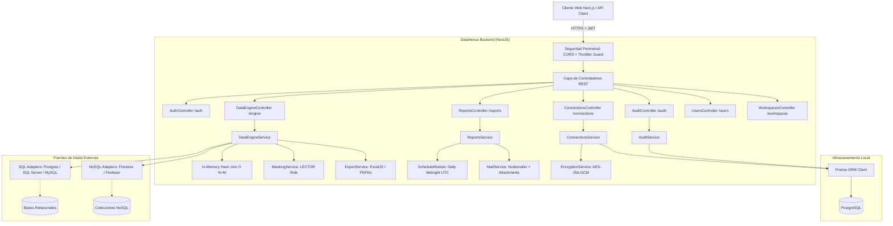

# Arquitectura Integral de DataNexus

> **Plataforma Unificada de Gestión de Datos Mixtas, Business Intelligence & Federación**  
> *Stack Tecnológico:* NestJS 12, TypeScript 5+, Prisma ORM, PostgreSQL (enums nativos para roles, motores y eventos), Swagger (OpenAPI).

---

## 1. Visión del Sistema
DataNexus es una plataforma empresarial diseñada para unificar silos relacionales (PostgreSQL, MySQL, SQL Server) y no relacionales (Firebase Firestore, MongoDB) en una experiencia unificada. Permite a perfiles técnicos y de negocio visualizar datos consolidados, realizar cruces entre bases heterogéneas (*Cross-Joins*), anonimizar información sensible según el rol del usuario, exportar informes corporativos (Excel, PDF, JSON) y programar despachos automatizados por correo electrónico.

---

## 2. Mapa de Fases del Proyecto

| Fase | Título | Descripción y Responsabilidad | Estado |
| :--- | :--- | :--- | :---: |
| **Fase 1** | **Cimientos Locales & ORM** | Configuración base de NestJS, SQLite para desarrollo local, PrismaClient global (`PrismaService`) y modelos fundacionales `Workspace` y `User`. | ✅ Completada |
| **Fase 2** | **Seguridad & Conexiones Cifradas** | Autenticación basada en JWT, encriptación simétrica AES-256-GCM para cadenas de conexión y CRUD seguro de `ConexionDB` (`ConnectionsModule`). | ✅ Completada (PR #1) |
| **Fase 3** | **Auditoría & Exploración de Esquemas** | Bitácora de eventos inmutable (`RegistroAuditoria`), control de roles (`ADMIN` / `LECTOR`) e introspección de esquemas externos mediante adaptadores. | ✅ Completada (PR #2) |
| **Fase 4** | **Motor de Cross-Joins en Memoria** | Algoritmo de unión relacional (*Inner Join*) en memoria con indexación hash $O(N + M)$ sobre tablas SQL y colecciones NoSQL con paginación nativa (`limit`, `offset`). | ✅ Completada (PR #3) |
| **Fase 5** | **Data Masking & Exportación** | Anonimización dinámica de correos, teléfonos y secretos para rol `LECTOR` (`MaskingService`) y generación de archivos binarios descargables en Excel (`exceljs`), PDF (`pdfkit`) y JSON (`ExportService`). | ✅ Completada (PR #3) |
| **Fase 6** | **Automatización de Reportes & Cron** | Programación periódica a la medianoche con `@nestjs/schedule` (CronJobs), servicio de despacho por correo (`nodemailer`) con reportes adjuntos para analistas. | ✅ Completada (Issue #4) |
| **Fase 7** | **Seguridad Perimetral, CORS & Rate Limiting** | Políticas CORS estrictas para Next.js (local y producción) y protección contra sobrecarga de CPU con `@nestjs/throttler` (20 req/min en exportaciones). | ✅ Completada (Issue #6) |
| **Fase 8** | **Ecosistema Empresarial & Miembros** | Gestión de miembros del Workspace, invitaciones con roles y contraseñas temporales, y aislamiento multi-tenant por Workspace. | ✅ Completada |

---

## 3. Diagrama de Arquitectura

---

## 4. Catálogo de Módulos y Endpoints Principales

### 4.1 Autenticación (`/auth`)
- `POST /auth/register`: Registro inicial de empresa, workspace y usuario administrador.
- `POST /auth/login`: Autenticación con email/contraseña. Abre una sesión y devuelve `access_token` (JWT de 15 min),
  `refresh_token` y `expires_in`.
- `POST /auth/refresh`: Rota el refresh token y emite un access token nuevo.

**Política de credenciales (RF-01/RF-02):**
- **Contraseñas** (registro, contraseña temporal de invitación y restablecimiento): entre 10 y 72 caracteres, con
  mayúscula, minúscula, número y símbolo, sin espacios al inicio o al final, sin contraseñas comunes y sin la parte
  local del correo. Implementada en `src/auth/validators/password-policy.ts` (`@IsStrongPassword()`).
- **Correo corporativo** en registro e invitaciones: se rechazan Gmail, Hotmail, Outlook, Yahoo, iCloud y otros
  proveedores personales. La lista se reemplaza con `BLOCKED_EMAIL_DOMAINS`; `ALLOW_PERSONAL_EMAILS=true` desactiva la
  regla para demos.
- **Bloqueo por intentos fallidos:** al 5.º intento fallido seguido (`LOGIN_MAX_ATTEMPTS`) la cuenta se bloquea
  15 minutos (`LOGIN_LOCK_MINUTES`) y el login responde `423 Locked` con los minutos restantes, incluso con la contraseña
  correcta. Un login correcto o restablecer la contraseña reinician el contador. Se auditan `LOGIN_FAILURE` (con el
  motivo y el número de intento) y `ACCOUNT_LOCKED`.
- `POST /auth/logout`: Cierra la sesión del refresh token (idempotente, 204).

**Sesiones (RF-04):** cada login crea una `UserSession` y el access token lleva su id (`sid`). `JwtStrategy` verifica
en cada petición que la sesión siga activa, así que el logout, la inactividad o una revocación invalidan también los
access tokens ya emitidos. Reglas:
- Más de 30 minutos sin peticiones ni renovaciones (`SESSION_IDLE_TIMEOUT_MINUTES`) cierran la sesión.
- Una sesión dura como máximo 7 días (`REFRESH_TOKEN_TTL_DAYS`) aunque haya actividad.
- El refresh token es de un solo uso. Presentar uno ya rotado se trata como robo: se revoca la sesión completa y se
  audita `REFRESH_TOKEN_REUSED`. Por eso el cliente debe hacer **una sola renovación a la vez**.
- Restablecer la contraseña cierra todas las sesiones del usuario.
- El frontend renueva el access token un minuto antes de que venza, solo si hubo interacción del usuario, y cierra la
  sesión tras 30 minutos sin interacción.
- `POST /auth/forgot-password`: Envía por correo un enlace de recuperación (RF-03). Responde siempre igual, exista o no
  el correo, para no revelar cuentas.
- `POST /auth/reset-password`: Guarda la nueva contraseña con el token del enlace. El token es aleatorio (256 bits),
  solo se almacena su hash SHA-256, vence a los 30 minutos (`PASSWORD_RESET_TTL_MINUTES`), es de un solo uso y pedir
  uno nuevo invalida el anterior. Ambos endpoints están limitados a 5 solicitudes cada 15 minutos por IP y se auditan
  como `PASSWORD_RESET_REQUESTED` y `PASSWORD_RESET`.

### 4.2 Conexiones de Datos (`/connections`)
- `POST /connections`: Alta con **credenciales estructuradas por motor** (RF-08, ADMIN). `credenciales` se valida
  según `tipoMotor` (unión discriminada; campos de otro motor → 400):

  | Motor | `credenciales` |
  | :--- | :--- |
  | `POSTGRESQL` / `MYSQL` | `host`, `port` (5432 / 3306), `database`, `username`, `password`, `ssl` (false) |
  | `SQLSERVER` | `host`, `port` (1433), `database`, `username`, `password`, `encrypt` (true), `trustServerCertificate` (false) |
  | `MONGODB` | `uri` (`mongodb://` o `mongodb+srv://`), `database` |
  | `FIRESTORE` | `serviceAccount` (objeto JSON), `databaseId` (`(default)`) |

- `POST /connections/firestore`: Alta de Firestore subiendo el **JSON de Service Account** (RF-09) en
  `multipart/form-data` (campo `serviceAccount`, máx. 64 KB, solo `.json`). Multer usa almacenamiento en memoria:
  el archivo **nunca se escribe en disco**. Se valida `type = service_account`, `project_id`, `client_email` y que
  `private_key` sea PEM; del JSON solo se conservan los campos necesarios.
- `POST /connections/test` (ADMIN) y `POST /connections/:id/test` (ADMIN u OPERADOR): prueban la conexión y miden la
  latencia (RF-10, issue #25) devolviendo `{ ok, latencyMs, serverVersion, error }`. La prueba previa recibe el mismo
  `tipoMotor` + `credenciales` que el alta, así que el formulario prueba exactamente lo que va a guardar; no persiste
  nada. Máximo 10 pruebas por minuto.
- `PUT /connections/:id/service-account`: Rotación del Service Account de una conexión Firestore (mismo formato).
- `GET /connections` y `GET /connections/:id`: Solo metadatos. `detalles` trae datos no secretos (puerto, usuario,
  ssl, projectId, clientEmail) y `formatoCredenciales` indica `ESTRUCTURADO` o `LEGADO`. Nunca se devuelven
  contraseñas, URIs ni claves privadas.
- `PATCH /connections/:id`: Con el mismo motor, `credenciales` puede traer solo lo que cambia (p. ej. rotar
  `password`); cambiar `tipoMotor` exige credenciales completas. Auditado sin valores (`changedFields`).
- `DELETE /connections/:id`: Baja física de la conexión (ADMIN).
- **Cifrado:** todo el payload de credenciales se cifra con `EncryptionService` (versión 2 en `credencialesVersion`).
  Las conexiones anteriores (versión 1, cadena libre) siguen funcionando y se migran al volver a guardar sus
  credenciales. `toDriverConnectionString()` traduce ambas versiones al formato de cada driver.

### 4.3 Motor de Datos & Federación (`/engine` o `/data-engine`)
- `GET /engine/connections/:id/schema`: Introspección de tablas, vistas o colecciones disponibles.
- `GET /engine/connections/:id/schema/fields`: Campos de una tabla o colección.
- `GET /engine/connections/:id/data?entidad=&esquema=&limite=&cursor=&filtros=`: Exploración paginada de una tabla o colección (issue #32, RNF-06). Devuelve la página y `nextCursor` (opaco, atado a la conexión, esquema y entidad). Cada motor usa su cursor nativo, sin `OFFSET` ni cargar la fuente: **keyset sobre la llave primaria** en PostgreSQL, MySQL y SQL Server (`(a > ?) OR (a = ? AND b > ?)`, también con llave compuesta), **`_id`** en MongoDB y **`startAfter`** por id de documento en Firestore. Cualquier página cuesta lo mismo: recorrer 1.000.000 de filas de PostgreSQL en páginas de 1.000 retiene ~1 MB de memoria (test de integración). Las tablas SQL sin llave primaria responden 400. `filtros` usa el formato del cross-join en JSON; aplica enmascaramiento para LECTOR y registra `BROWSE_DATA` al iniciar cada recorrido.
- `POST /engine/join`: Cross-join en memoria con paginación (`limit`, `offset`) y enmascaramiento dinámico para rol `LECTOR`. Acepta dos formatos (issue #30):
  - **N fuentes** (`fuentes` + `relaciones`): de 2 a 5 tablas o colecciones de cualquier motor; cada relación es `INNER`, `LEFT`, `RIGHT` o `FULL` con 1 a 3 pares de llaves (llave compuesta). La primera relación une dos fuentes y cada una de las siguientes añade una fuente nueva a una ya unida (sin ciclos). Las columnas repetidas entre fuentes se califican con el alias (`clientes.email`).
  - **Original** (`conexionSqlId`, `tablaSql`, `conexionNoSqlId`, `coleccionNoSql`, `llaveSql`, `llaveNoSql`): sigue igual (columnas repetidas como `sql.campo` / `nosql.campo`) y admite `tipoJoin`.
  - Las llaves se normalizan antes de comparar (1 y `"1"` coinciden, `ObjectId` como texto) y las nulas nunca cruzan. Benchmark con 100.000 filas por fuente en [`docs/BENCHMARK-CROSS-JOIN.md`](BENCHMARK-CROSS-JOIN.md).
  - **Filtros (issue #31, RF-15):** `eq`, `neq`, `gt`, `gte`, `lt`, `lte`, `in`, `not-in`, `between` (`[mínimo, máximo]`, números o fechas ISO), `contains` y `startsWith` (sin distinguir mayúsculas; `%` y `_` se buscan literalmente) e `isNull` (`true`/`false`). Se agrupan con `{ "logica": "AND" | "OR", "filtros": [...] }` hasta 3 niveles y 20 condiciones por fuente; la lista de primer nivel se combina con AND.
    - **Pushdown:** PostgreSQL, MySQL, SQL Server y MongoDB ejecutan todos los filtros en el motor (parámetros, `LOWER(...) LIKE ... ESCAPE '!'`, `$or`/`$and`, `$regex` escapado). Firestore ejecuta comparaciones, `in`, `between` e `isNull`; `contains`, `startsWith` y los grupos los evalúa `DataEngineService` en memoria tras la extracción (`IDataSourceAdapter.canPushDown` / `pushesFilterGroups`).
    - **Misma semántica en todos los motores:** `neq` y `not-in` no incluyen nulos (como en SQL). Un test de integración compara PostgreSQL, MongoDB y la evaluación en memoria con los mismos datos y filtros, incluidos intentos de inyección.
  - **`limiteFilas` (RF-16):** `50`, `100`, `500` o `1000`. Recorta el resultado después del join y la respuesta incluye `truncado: true` si había más filas.
- `POST /engine/export`: Generación y descarga directa de archivos (`format: excel | pdf | json`) con rate limiting estricto (20 req/min).
- **Joins asíncronos (issue #33, RNF-04):** para cruces pesados que no conviene esperar en una sola petición. Mismo payload y permiso (`RUN_JOINS`) que `POST /engine/join`.
  - `POST /engine/jobs` valida el payload, lo encola y responde `202` con el `id` (estado `EN_COLA`). `GET /engine/jobs/:id?offset=&limit=` devuelve estado (`EN_COLA`, `EN_PROCESO`, `COMPLETADO`, `FALLIDO`, `CANCELADO`), progreso (0-100) y, al completar, el resultado paginado. `DELETE /engine/jobs/:id` cancela un job en cola (no llega a ejecutarse) o en proceso (se detiene en la siguiente pausa). `GET /engine/jobs` lista los jobs propios (ADMIN ve todos los del workspace).
  - **No bloquea el event loop:** el join, el armado de columnas y el de filas ceden el event loop cada 2.000 filas (`executeJoinPlanAsync`). Con 200.000 x 200.000 filas la pausa máxima del servidor es de ~30 ms, frente a ~900 ms del mismo join síncrono (test).
  - **Cola:** con `REDIS_URL`, **BullMQ + Redis** (los jobs se reparten entre réplicas y el resultado se guarda como lista de Redis, paginada con `LRANGE`). Sin `REDIS_URL`, una cola en memoria con la misma API (solo una instancia; para desarrollo). `docker compose up -d redis` levanta Redis en local.
  - **Límites y expiración:** `JOBS_CONCURRENCY` (2 por instancia), `JOBS_MAX_ACTIVE_PER_WORKSPACE` (3 en cola o en proceso; el siguiente responde 429) y `JOBS_RESULT_TTL_SECONDS` (3600): pasado ese tiempo el estado y el resultado se borran solos. El payload (con sus filtros) se borra al terminar.
  - El resultado se guarda ya enmascarado según el rol de quien pidió el job; solo lo ven su autor y los ADMIN del workspace. Al terminar se registra `EXECUTE_JOIN` en la bitácora con la IP original.

**Adaptadores de fuentes de datos (RNF-10, issues #27, #28 y #29).** `DataEngineService` solo conoce la interfaz
`IDataSourceAdapter` (`listObjects`, `listFields`, `extract` y `capabilities`) y obtiene el adaptador del motor con
`AdapterRegistry` (acepta alias como "SQL Server" o "Firebase"). Agregar un motor = crear su adaptador y añadirlo a
`DATA_SOURCE_ADAPTER_CLASSES` en `adapters/adapter-providers.ts`; el servicio no cambia.

| Motor | Explorar | Campos | Extraer (cross-join) |
| :--- | :---: | :---: | :---: |
| PostgreSQL | ✅ | ✅ | ✅ |
| MySQL / MariaDB | ✅ | ✅ | ✅ |
| SQL Server | ✅ | ✅ | ✅ |
| Firestore | ✅ | ✅ (muestreo) | ✅ |
| MongoDB | ✅ (colecciones y vistas) | ✅ (muestreo de 100 documentos) | ✅ |

- **Pool de clientes (`DataSourceClientPool`):** reutiliza un cliente por conexión y credenciales (pg.Pool, pool de
  mysql2, ConnectionPool de mssql, instancia de Firestore, MongoClient). Cierra los inactivos tras `DATA_SOURCE_POOL_IDLE_MS`
  (5 min) y los menos usados si se superan `DATA_SOURCE_POOL_MAX_ENTRIES` (50). `ConnectionsService` lo invalida al
  editar o eliminar una conexión, el motor lo invalida tras un timeout y al apagar la aplicación
  (`enableShutdownHooks` + `OnModuleDestroy`) no queda ninguna conexión abierta.
- **Extractor MySQL:** valida tablas y columnas contra `information_schema`, escapa identificadores con comillas
  invertidas, traduce los filtros a `WHERE` con parámetros `?` (filter pushdown), limita a `DATA_ENGINE_MAX_SOURCE_ROWS`
  + 1 filas, corta en el servidor con `MAX_EXECUTION_TIME` y estima el tamaño de cada fila en el servidor para no
  transferir filas que superen `DATA_ENGINE_MAX_SOURCE_BYTES`. Lee en streaming y descarta la conexión si corta a mitad.
- **Extractor PostgreSQL:** las mismas garantías que MySQL, con identificadores entre comillas dobles, parámetros
  `$1, $2…`, `statement_timeout` y lectura fila a fila. Sin esquema usa `public` o el primero que tenga la tabla.
- **Adaptador MongoDB (#29):** colecciones y vistas de la base configurada, campos por muestreo (`$sample`) y
  extracción con los filtros traducidos a `$eq`, `$ne`, `$gt`, `$gte`, `$lt`, `$lte`, `$in` y `$nin`. Solo acepta valores
  escalares y campos sin segmentos que empiecen por `$`, así que no se pueden inyectar operadores. Convierte los tipos BSON
  a JSON (`ObjectId` a texto para poder cruzar `_id` con SQL) y tiene prueba de conexión propia.

### 4.4 Auditoría (`/audit`)
- `GET /audit/logs`: Consulta paginada (`page`, `limit`) con filtros por `fechaInicio`, `fechaFin` y `tipoAccion` (ADMIN o AUDITOR).
- `GET /audit/logs/export?format=csv|json`: Descarga la bitácora con los mismos filtros (máximo 10 000 registros por archivo). La exportación queda registrada como `AUDIT_LOG_EXPORTED`.

**Eventos registrados:** `LOGIN_SUCCESS`, `LOGIN_FAILURE`, `USER_ROLE_CHANGED`, `USER_INVITED`, `CONNECTION_CREATED`,
`CONNECTION_UPDATED`, `CONNECTION_DELETED`, `REPORT_GENERATED_AND_SENT`, `EXECUTE_JOIN`, `EXPORT`, `BROWSE_DATA`, `AUDIT_LOG_EXPORTED`
y `MODIFY_RECORD` (reservado para la edición de celdas). Cada evento guarda usuario, fecha UTC, IP, user agent, resultado
(`SUCCESS`/`FAILURE`) y la entidad afectada (`targetType`/`targetId`, p. ej. `dbo.clientes x pedidos` en un Cross-Join).
Nunca se guardan valores de filtros, filas ni credenciales.

**Inmutabilidad (RF-26):** la tabla `RegistroAuditoria` es de solo inserción en dos capas:
1. `PrismaService` rechaza `update`, `upsert` y `delete` sobre el modelo antes de llegar a la base de datos.
2. Un trigger de PostgreSQL (`registro_auditoria_inmutable`) bloquea `UPDATE`, `DELETE` y `TRUNCATE`, incluso desde
   SQL directo o clientes externos como psql.

### 4.5 Reportes Programados (`/reports`)
- `POST /reports/trigger`: Disparo manual de consulta, generación en streaming y envío por correo electrónico con un enlace seguro de 24 horas (ADMIN u OPERADOR).
- `GET /reports/download/:id`: Descarga transmitida con firma HMAC en modo local; en GCS el correo usa una URL firmada V4 de 24 horas.
- El backend usa GCS cuando `REPORT_STORAGE_PROVIDER=gcs`; en desarrollo usa almacenamiento local configurable con `REPORTS_LOCAL_DIRECTORY`.
- Los enlaces de descarga son bearer: cualquier persona que tenga el enlace puede usarlo hasta su vencimiento; el bucket GCS debe permanecer privado.
- *Cron Job automático:* Ejecución programada diaria a la medianoche (UTC).

### 4.6 Gestión de Miembros (`/users`)
- `GET /users`: Listado de todos los miembros del Workspace.
- `PATCH /users/:id/role`: Modificación de permisos de usuario (ADMIN).
- `DELETE /users/:id`: Baja de un miembro (ADMIN). Borra la cuenta y, en cascada, sus sesiones, así que sus tokens
  dejan de funcionar al instante. Nadie puede darse de baja a sí mismo y el workspace nunca se queda sin `ADMIN`
  (409): la comprobación bloquea con `SELECT ... FOR UPDATE` las filas de ADMIN, de modo que dos ADMIN que se dan de
  baja mutuamente a la vez no pueden dejar el workspace vacío. La misma regla aplica al quitar el rol `ADMIN`.

**Invitaciones por enlace (RF-06).** El usuario se crea al aceptar, con la contraseña que él elige; ya no existen
contraseñas temporales.
- `POST /users/invite`: Crea una invitación (correo, nombre, rol) y envía el enlace `FRONTEND_URL/accept-invite?token=…`.
  Respeta `dominiosPermitidos`; responde 409 si el correo ya tiene cuenta o una invitación pendiente. Si el correo no
  sale, la invitación se conserva con `correoEnviado: false` para reenviarla.
- `GET /users/invitations?estado=`: Lista las invitaciones (`PENDIENTE`, `ACEPTADA`, `REVOCADA` o `EXPIRADA`, que es
  una pendiente vencida).
- `POST /users/invitations/:id/resend`: Genera un token nuevo (el anterior deja de servir) y renueva el vencimiento.
- `DELETE /users/invitations/:id`: Revoca una invitación pendiente.
- `POST /auth/invitation-preview` y `POST /auth/accept-invite` (públicos, 10 intentos cada 15 min por IP): consultan y
  aceptan la invitación. El token va en el body, es aleatorio (256 bits), solo se guarda su hash SHA-256, vence a las
  `INVITATION_TTL_HOURS` (72 por defecto) y es de un solo uso (consumo atómico).
- Todo queda auditado: `USER_INVITED`, `INVITATION_RESENT`, `INVITATION_REVOKED`, `INVITATION_ACCEPTED` y `USER_REMOVED`.

### 4.7 Espacio de Trabajo (`/workspaces`) — RF-05
- `GET /workspaces/me`: Datos del workspace del token (nombre, logo, zona horaria IANA). La `configuracion`
  (dominios permitidos y campos sensibles por defecto) solo se incluye para `ADMIN`.
- `PATCH /workspaces/me`: Cambio parcial de nombre, `logoUrl` (https; `null` lo elimina), `zonaHoraria`,
  `dominiosPermitidos` (sin proveedores de correo personal) y `camposSensibles` (ADMIN). El cambio y el evento
  `WORKSPACE_UPDATED` (con antes/después) se guardan en la misma transacción.
- `GET /workspaces/me/stats`: Miembros por rol, conexiones por motor y reportes enviados (cualquier rol).
- **Aislamiento multi-tenant:** el workspace se obtiene siempre del JWT, nunca de la URL ni del body; no existe
  ruta para leer o modificar otro workspace. `workspace-isolation.integration.spec.ts` lo verifica contra
  PostgreSQL para workspaces, miembros, conexiones y bitácora.
- `camposSensibles` queda almacenado para el enmascaramiento configurable (RF-20, issue #34).

---

## 5. Matriz de Roles y Seguridad (RBAC)

DataNexus aplica la segregación de funciones de 4 roles definida en el Dossier Técnico. La matriz vive en código en
`src/auth/interfaces/user-role.ts` (`ROLE_PERMISSIONS`) y se aplica en dos capas: `@RequirePermission()` + `RolesGuard`
en los controladores y `hasPermission()` en los servicios (defensa en profundidad).

| Permiso (`ROLE_PERMISSIONS`) | ADMIN | OPERADOR (Analista BI) | LECTOR | AUDITOR de TI |
| :--- | :---: | :---: | :---: | :---: |
| `MANAGE_CONNECTIONS` · Crear / editar / borrar conexiones | ✅ | ❌ | ❌ | ❌ |
| `VIEW_CONNECTIONS` · Listar conexiones y su salud | ✅ | ✅ | ❌ | ❌ |
| `EXPLORE_DATA` · Explorar esquemas y campos externos | ✅ | ✅ | ❌ | ❌ |
| `RUN_JOINS` · Ejecutar Cross-Joins | ✅ | ✅ | ❌ | ❌ |
| `EXPORT_DATA` · Exportar a Excel / PDF / JSON | ✅ | ✅ | ❌ | ❌ |
| `MANAGE_REPORTS` · Disparar / programar reportes | ✅ | ✅ | ❌ | ❌ |
| `READ_AUDIT` · Consultar la bitácora de auditoría | ✅ | ❌ | ❌ | ✅ |
| `MANAGE_MEMBERS` · Invitar miembros y cambiar roles | ✅ | ❌ | ❌ | ❌ |
| `MANAGE_WORKSPACE` · Editar datos y configuración del workspace | ✅ | ❌ | ❌ | ❌ |
| `VIEW_UNMASKED_DATA` · Ver datos sin enmascarar | ✅ | ✅ | ❌ | ❌ |

- El `MaskingService` es *fail-closed*: cualquier rol sin `VIEW_UNMASKED_DATA` (LECTOR, AUDITOR o un rol desconocido)
  recibe correos, teléfonos y secretos enmascarados.
- El LECTOR consumirá consultas predefinidas (Consultas Guardadas, Sprint 3) siempre con datos enmascarados.
- Los endpoints protegidos responden `403 Forbidden` cuando el rol no tiene el permiso.

---

## 6. Pruebas y Aseguramiento de Calidad
El proyecto cuenta con una cobertura integral de pruebas unitarias sobre todos los dominios:
- **Pruebas de Cifrado:** Validación de vectores de inicialización (IV), autenticación GCM e integridad criptográfica.
- **Pruebas de Conexión y Exploración:** Manejo de timeouts (10s), liberación de conexiones y sanitización de metadatos.
- **Pruebas de Cross-Join:** Validación de unicidad de llaves, relaciones $1:N$, enmascaramiento y paginación.
- **Pruebas de Exportación y Correo:** Verificación de encabezados binarios (`%PDF`, `.xlsx`) y despacho simulado.
- **Ejecución de Tests:** `npm run test` (65 tests pasando en 16 suites).
