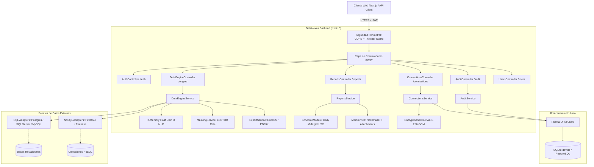

# Arquitectura Integral de DataNexus

> **Plataforma Unificada de Gestión de Datos Mixtas, Business Intelligence & Federación**  
> *Stack Tecnológico:* NestJS 12, TypeScript 5+, Prisma ORM, SQLite / PostgreSQL, Swagger (OpenAPI).

---

## 1. Visión del Sistema
DataNexus es una plataforma empresarial diseñada para unificar silos relacionales (PostgreSQL, MySQL, SQL Server) y no relacionales (Firebase Firestore, MongoDB) en una experiencia unificada. Permite a perfiles técnicos y de negocio visualizar datos consolidados, realizar cruces entre bases heterogéneas (*Cross-Joins*), anonimizar información sensible según el rol del usuario, exportar informes corporativos (Excel, PDF, JSON) y programar despachos automatizados por correo electrónico.

---

## 2. Mapa de Fases del Proyecto

| Fase | Título | Descripción y Responsabilidad | Estado |
| :--- | :--- | :--- | :---: |
| **Fase 1** | **Cimientos Locales & ORM** | Configuración base de NestJS, SQLite para desarrollo local, PrismaClient global (`PrismaService`) y modelos fundacionales `Workspace` y `User`. | ✅ Completada |
| **Fase 2** | **Seguridad & Conexiones Cifradas** | Autenticación basada en JWT, encriptación simétrica AES-256-GCM para cadenas de conexión y CRUD seguro de `ConexionDB` (`ConnectionsModule`). | ✅ Completada (PR #1) |
| **Fase 3** | **Auditoría & Exploración de Esquemas** | Bitácora de eventos inmutable (`RegistroAuditoria`), control de roles (`ADMIN` / `LECTOR`) e introspección de esquemas externos mediante adaptadores. | ✅ Completada (PR #2) |
| **Fase 4** | **Motor de Cross-Joins en Memoria** | Algoritmo de unión relacional (*Inner Join*) en memoria con indexación hash $O(N + M)$ sobre tablas SQL y colecciones NoSQL con paginación nativa (`limit`, `offset`). | ✅ Completada (PR #3) |
| **Fase 5** | **Data Masking & Exportación** | Anonimización dinámica de correos, teléfonos y secretos para rol `LECTOR` (`MaskingService`) y generación de archivos binarios descargables en Excel (`exceljs`), PDF (`pdfkit`) y JSON (`ExportService`). | ✅ Completada (PR #3) |
| **Fase 6** | **Automatización de Reportes & Cron** | Programación periódica a la medianoche con `@nestjs/schedule` (CronJobs), servicio de despacho por correo (`nodemailer`) con reportes adjuntos para analistas. | ✅ Completada (Issue #4) |
| **Fase 7** | **Seguridad Perimetral, CORS & Rate Limiting** | Políticas CORS estrictas para Next.js (local y producción) y protección contra sobrecarga de CPU con `@nestjs/throttler` (20 req/min en exportaciones). | ✅ Completada (Issue #6) |
| **Fase 8** | **Ecosistema Empresarial & Miembros** | Gestión de miembros del Workspace, invitaciones con roles y contraseñas temporales, y aislamiento multi-tenant por Workspace. | ✅ Completada |

---

## 3. Diagrama de Arquitectura

---

## 4. Catálogo de Módulos y Endpoints Principales

### 4.1 Autenticación (`/auth`)
- `POST /auth/register`: Registro inicial de empresa, workspace y usuario administrador.
- `POST /auth/login`: Autenticación con email/contraseña y emisión de token JWT.

### 4.2 Conexiones de Datos (`/connections`)
- `POST /connections`: Alta de conexión externa cifrando credenciales con AES-256 (ADMIN).
- `GET /connections`: Listado seguro de conexiones activas del Workspace (sin exponer secretos).
- `PATCH /connections/:id`: Actualización auditada de parámetros de conexión (ADMIN).
- `DELETE /connections/:id`: Baja lógica y física de conexión (ADMIN).

### 4.3 Motor de Datos & Federación (`/engine` o `/data-engine`)
- `GET /engine/connections/:id/schema`: Introspección de tablas, vistas o colecciones disponibles.
- `POST /engine/join`: Ejecución del Inner Join cruzado SQL $\times$ NoSQL con paginación (`limit`, `offset`) y enmascaramiento dinámico para rol `LECTOR`.
- `POST /engine/export`: Generación y descarga directa de archivos (`format: excel | pdf | json`) con rate limiting estricto (20 req/min).

### 4.4 Auditoría (`/audit`)
- `GET /audit/logs`: Consulta paginada (`page`, `limit`) con filtros por `fechaInicio`, `fechaFin` y `tipoAccion` (ADMIN).

### 4.5 Reportes Programados (`/reports`)
- `POST /reports/trigger`: Disparo manual de consulta, generación de adjunto y envío por correo electrónico (ADMIN).
- *Cron Job automático:* Ejecución programada diaria a la medianoche (UTC).

### 4.6 Gestión de Miembros (`/users`)
- `GET /users`: Listado de todos los miembros del Workspace.
- `POST /users/invite`: Invitación o alta de un nuevo miembro con rol `ADMIN` o `LECTOR` (ADMIN).
- `PATCH /users/:id/role`: Modificación de permisos de usuario (ADMIN).

---

## 5. Matriz de Roles y Seguridad (RBAC)

| Funcionalidad | Rol ADMIN | Rol LECTOR |
| :--- | :---: | :---: |
| Crear / Editar / Borrar Conexiones | ✅ Permitido | ❌ Denegado (`403 Forbidden`) |
| Explorar Esquemas Externos | ✅ Permitido | ✅ Permitido |
| Ejecutar Cross-Joins | ✅ Datos completos | ⚠️ Datos enmascarados (`***@...`, `***`) |
| Exportar a Excel y PDF | ✅ Datos completos | ⚠️ Datos enmascarados |
| Consultar Logs de Auditoría | ✅ Permitido | ❌ Denegado (`403 Forbidden`) |
| Disparar / Automatizar Reportes | ✅ Permitido | ❌ Denegado (`403 Forbidden`) |
| Invitar Miembros y Cambiar Roles | ✅ Permitido | ❌ Denegado (`403 Forbidden`) |

---

## 6. Pruebas y Aseguramiento de Calidad
El proyecto cuenta con una cobertura integral de pruebas unitarias sobre todos los dominios:
- **Pruebas de Cifrado:** Validación de vectores de inicialización (IV), autenticación GCM e integridad criptográfica.
- **Pruebas de Conexión y Exploración:** Manejo de timeouts (10s), liberación de conexiones y sanitización de metadatos.
- **Pruebas de Cross-Join:** Validación de unicidad de llaves, relaciones $1:N$, enmascaramiento y paginación.
- **Pruebas de Exportación y Correo:** Verificación de encabezados binarios (`%PDF`, `.xlsx`) y despacho simulado.
- **Ejecución de Tests:** `npm run test` (65 tests pasando en 16 suites).
